# EDTR: free editors that run in your browser

Editors for text, PDFs, images, sound, video, vector art, 3D models and page
layout, plus a screen recorder. They run right in your browser, install like
regular apps, and keep your files on your own device. No account, nothing
uploaded.

Made by [Dave Ghidiu](https://daveghidiu.com) with Claude. Provided by the
[FLX AI Hub](https://flcc.ai) and [Finger Lakes Community College](https://www.flcc.edu).

## Where this came from

The suite started with **TXTEDTR**, a text and code editor made as a useful tool
for people who are new to vibe coding: color-coded code, a live preview for HTML
and Markdown, and a warning when pasted text hides curly quotes or invisible
characters.

Building something is only part of the job, though. Once you have a project, you need the content around it: a how-to guide with screenshots, a PDF form people can fill in, a podcast clip, a screen recording, a video, a logo, a flyer. So the project grew one tool at a time, each addressing a piece of content creation that wouldn't require expertise, an account, an upload, a subscription or a big install:

| After TXTEDTR came | To help with |
|---|---|
| PDFEDTR | forms, signatures and merging pages |
| IMGEDTR | screenshots and how-to guides |
| SNDEDTR | audio and podcasts |
| VIDEDTR | video |
| SCRNCSTR | screen and webcam recordings |
| VCTREDTR | vector art |
| 3DEDTR | 3D models for printing |
| DSKEDTR | newsletters, flyers and booklets |

## Why it is built this way

- **Free.** Anyone can use the apps, and the code is MIT licensed.
- **Private by default.** Everything happens in the browser. Files are opened,
  edited and saved on your own device and are never sent to a server.
- **Nothing to set up.** Open the address and start working. Each app can also
  be installed from the browser and opens in its own window, like any other app.
- **Plain web technology.** HTML, CSS and JavaScript, with no build step, so the
  code is easy to read, change and learn from.
- **One family.** The apps share the same look, naming and habits (light and
  dark mode, a built-in help panel, a changelog), so learning one makes the next
  easier.
- **Mobile friendly.** Every app is tested on phones, tablets, and desktop. Intentionality at every size!

## The apps

| | App | What it does |
|---|---|---|
|  | [**TXTEDTR**](https://txtedtr.app) | A clean, fast text and code editor with tabs, syntax highlighting for over ten languages, and a live preview for HTML and Markdown. |
| 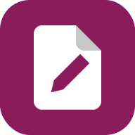 | [**PDFEDTR**](https://pdfedtr.app) | Turn any PDF into a fillable form, fill it in and sign it, and rearrange or merge pages, without uploading it anywhere. |
| 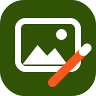 | [**IMGEDTR**](https://imgedtr.app) | A quick image editor for screenshots and how-to guides: hide private details, spotlight what matters, and add numbered steps, big cursors and text. |
| 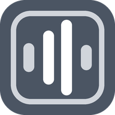 | [**SNDEDTR**](https://sndedtr.app) | Record, trim and clean up audio on several tracks, with noise reduction, EQ and export to WAV, MP3 or Opus. |
|  | [**VIDEDTR**](https://videdtr.app) | A real multitrack video editor: cut clips, blur what needs hiding, add titles, effects and transitions, and export. |
|  | [**SCRNCSTR**](https://scrncstr.app) | Record your screen and webcam together or as separate files, with a webcam bubble you can drag, resize and reshape. |
| 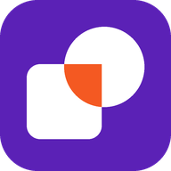 | [**VCTREDTR**](https://vctredtr.app) | Draw vector art and merge shapes the way PowerPoint does (union, subtract, fragment and more), with a live view of the SVG code. |
| 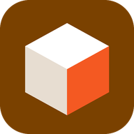 | [**3DEDTR**](https://3dedtr.app) | Build 3D models from simple shapes, cut and merge them, and export them ready for the 3D printer, all measured in millimeters. |
| 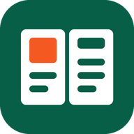 | [**DSKEDTR**](https://dskedtr.app) | Lay out newsletters, flyers and booklets: text flows from box to box and page to page, with shapes, pictures, master pages and a PDF ready to print. |


## A look at each one

### TXTEDTR: write and preview code

<table>
<tr>
<td width="50%">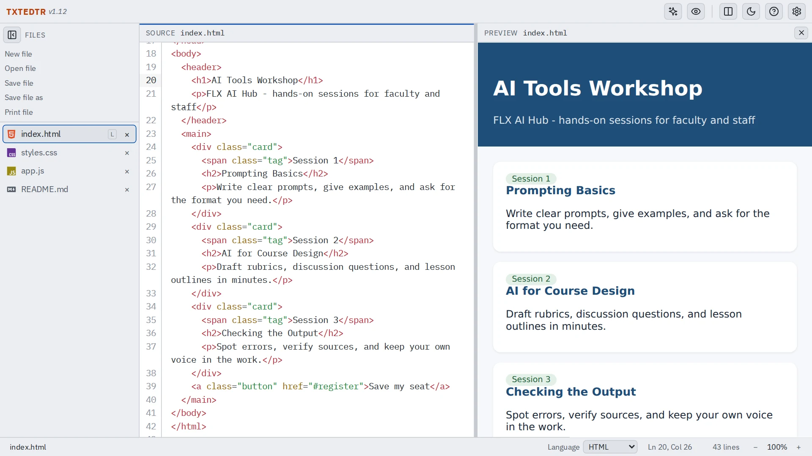<br><sub><b>Live HTML preview.</b> See the page as you type.</sub></td>
<td width="50%">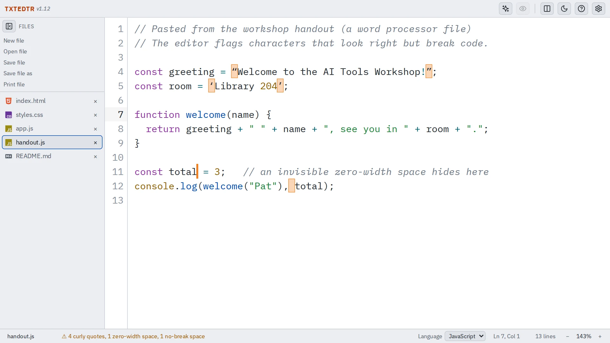<br><sub><b>Catches hidden characters.</b> Curly quotes and invisible spaces get boxed.</sub></td>
</tr>
</table>

### PDFEDTR: fill, sign and rearrange PDFs

<table>
<tr>
<td width="50%">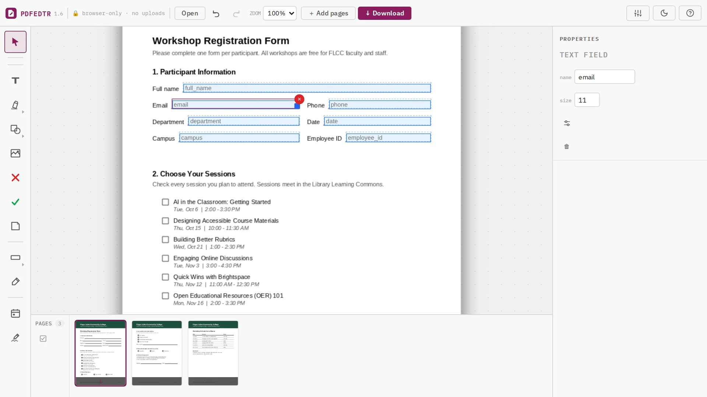<br><sub><b>Add fillable text fields</b> to any PDF.</sub></td>
<td width="50%">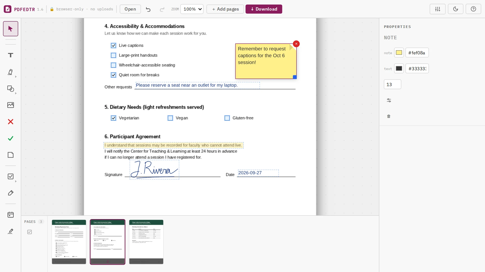<br><sub><b>Fill, annotate and sign.</b></sub></td>
</tr>
</table>

### IMGEDTR: screenshots and how-to guides

<table>
<tr>
<td width="50%">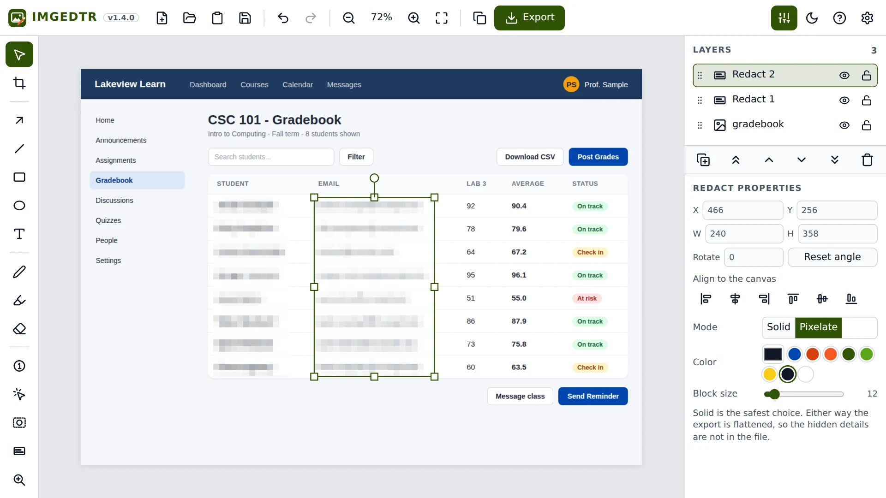<br><sub><b>Hide private info</b> before you share a screenshot.</sub></td>
<td width="50%">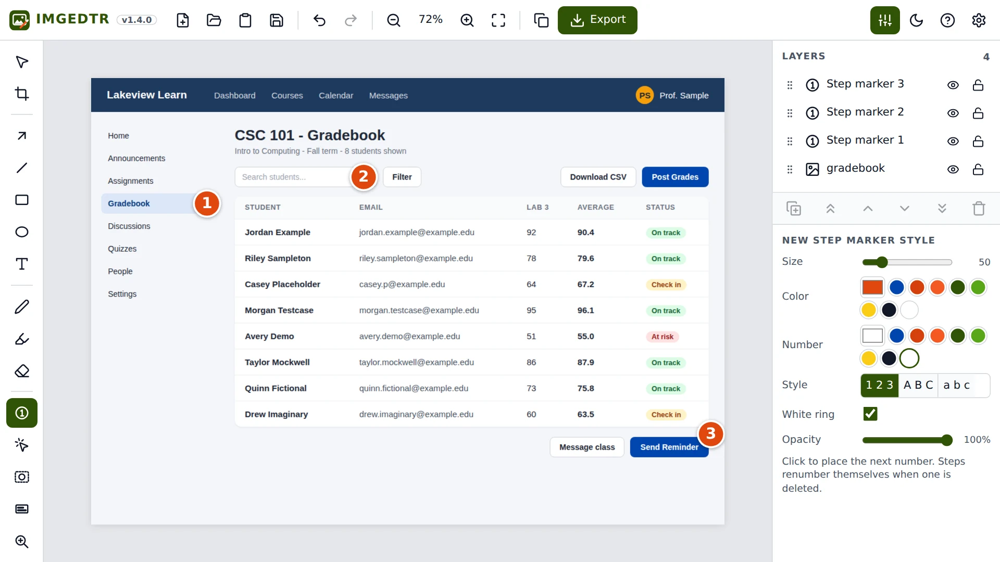<br><sub><b>Numbered click steps</b> that show where to go.</sub></td>
</tr>
</table>

### SNDEDTR: record and edit audio

<table>
<tr>
<td width="50%">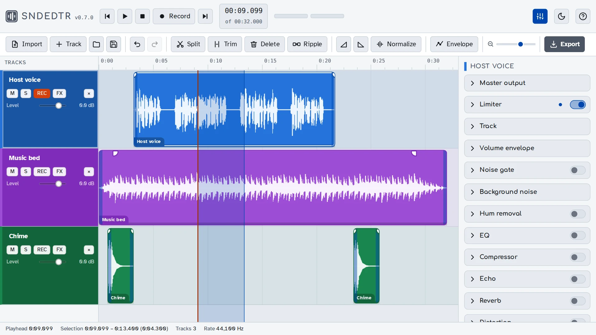<br><sub><b>Multitrack editing.</b></sub></td>
<td width="50%">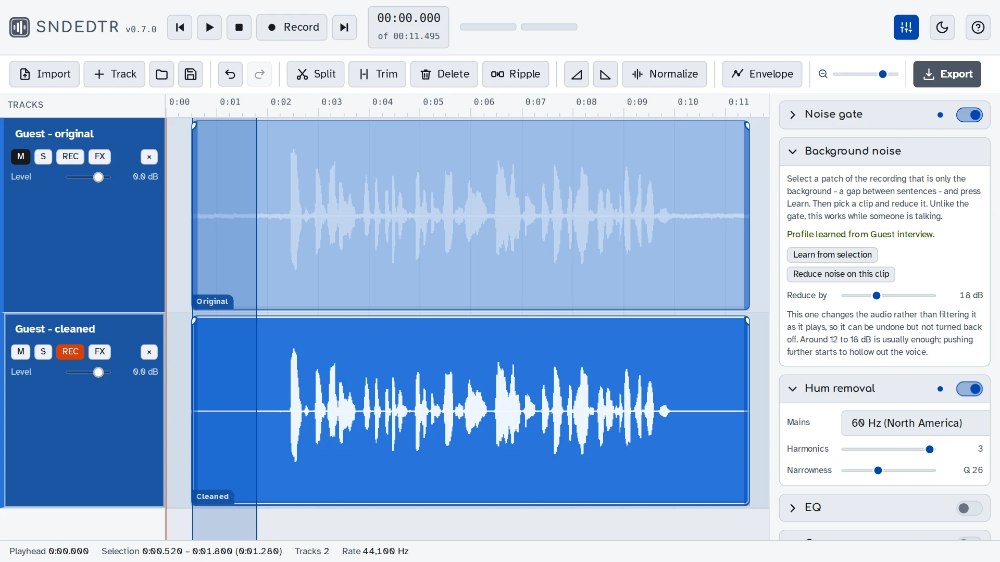<br><sub><b>Clean up noisy audio.</b></sub></td>
</tr>
</table>

### VIDEDTR: edit video

<table>
<tr>
<td width="50%">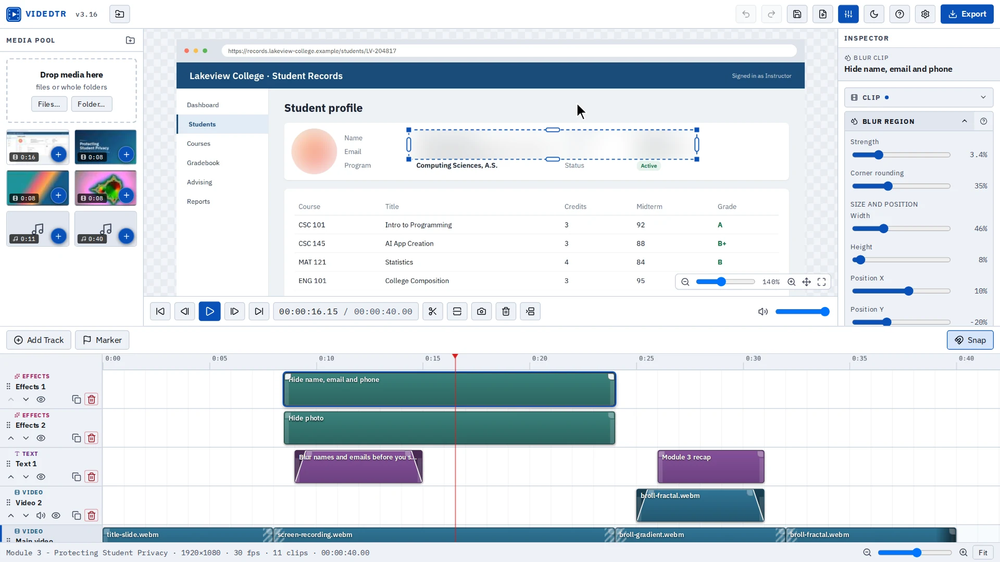<br><sub><b>Blur private information</b> in a screen recording.</sub></td>
<td width="50%">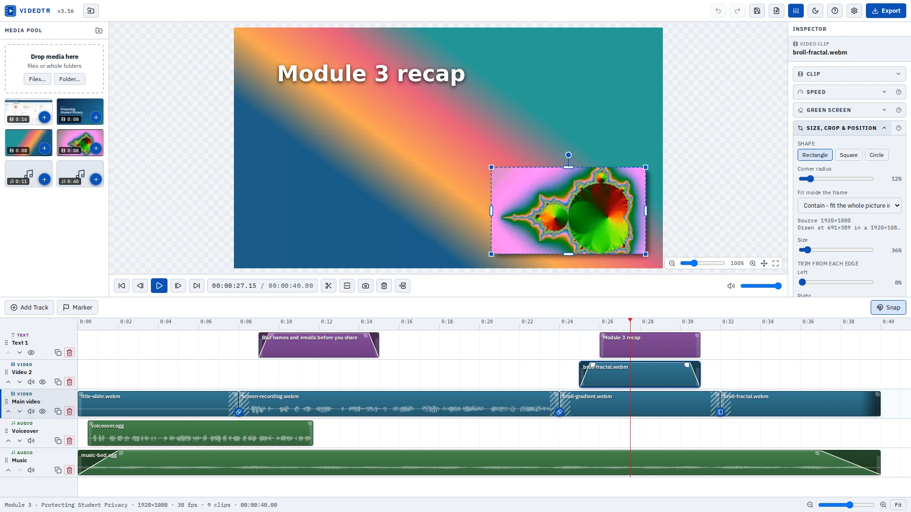<br><sub><b>Multitrack timeline.</b></sub></td>
</tr>
</table>

### SCRNCSTR: record your screen

<table>
<tr>
<td width="50%"><br><sub><b>Place your webcam anywhere.</b></sub></td>
<td width="50%">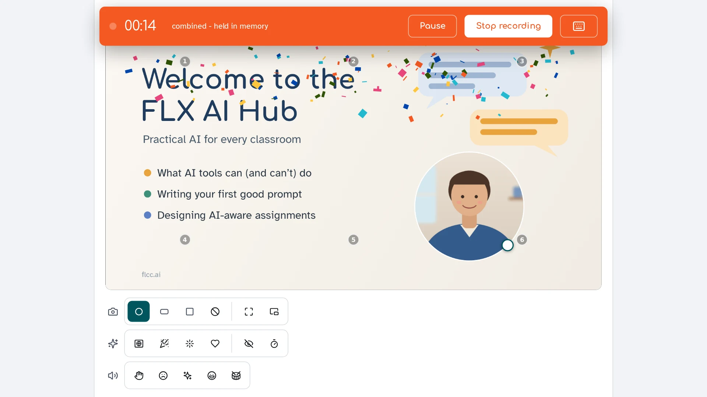<br><sub><b>Live effects while recording.</b></sub></td>
</tr>
</table>

### VCTREDTR: vector art

<table>
<tr>
<td width="50%">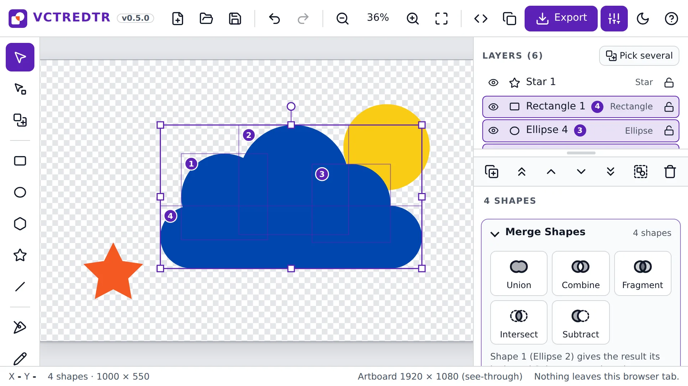<br><sub><b>Merge shapes</b> with union, subtract and more.</sub></td>
<td width="50%">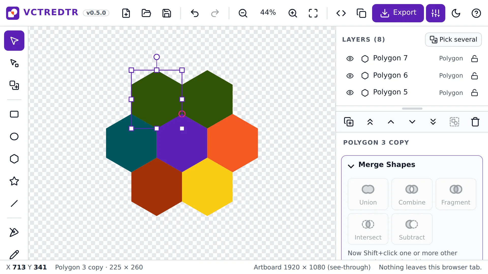<br><sub><b>Perfect shapes that tile.</b></sub></td>
</tr>
</table>

### 3DEDTR: 3D models for printing

<table>
<tr>
<td width="50%">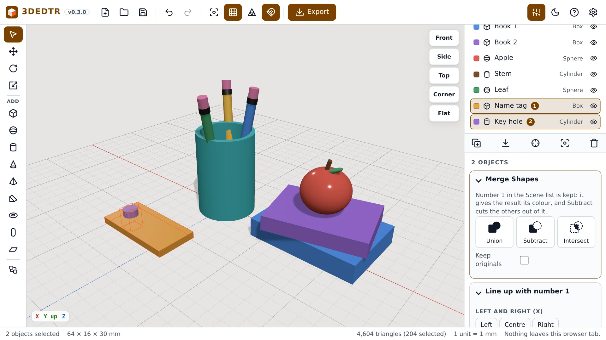<br><sub><b>Cut shapes to build.</b></sub></td>
<td width="50%">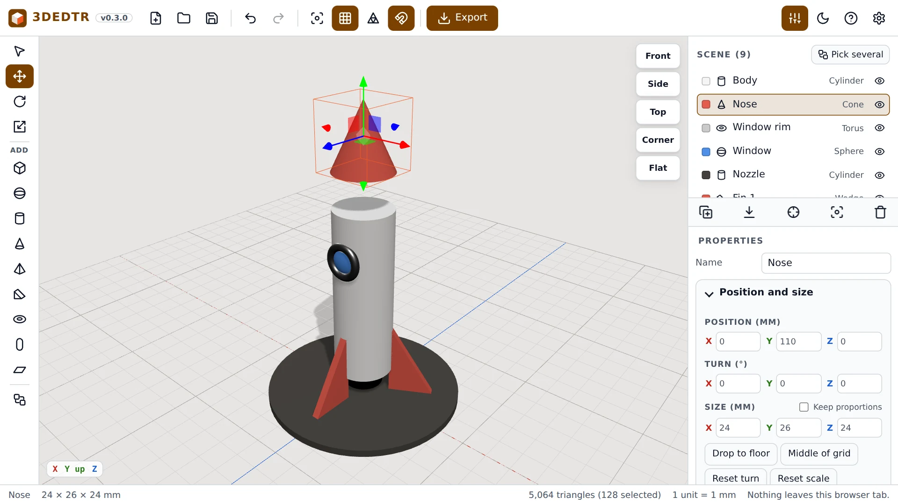<br><sub><b>Build from simple shapes</b>, measured in millimeters.</sub></td>
</tr>
</table>

### DSKEDTR: page layout

<table>
<tr>
<td width="50%">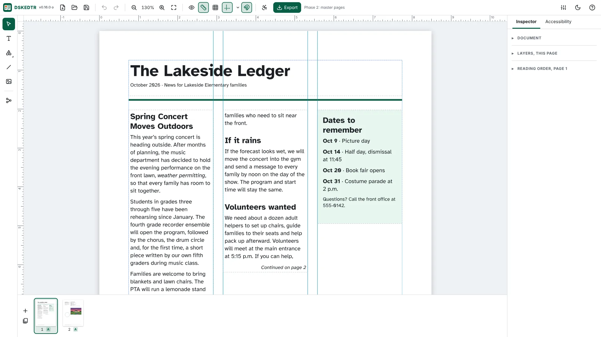<br><sub><b>Lay out a newsletter.</b></sub></td>
<td width="50%">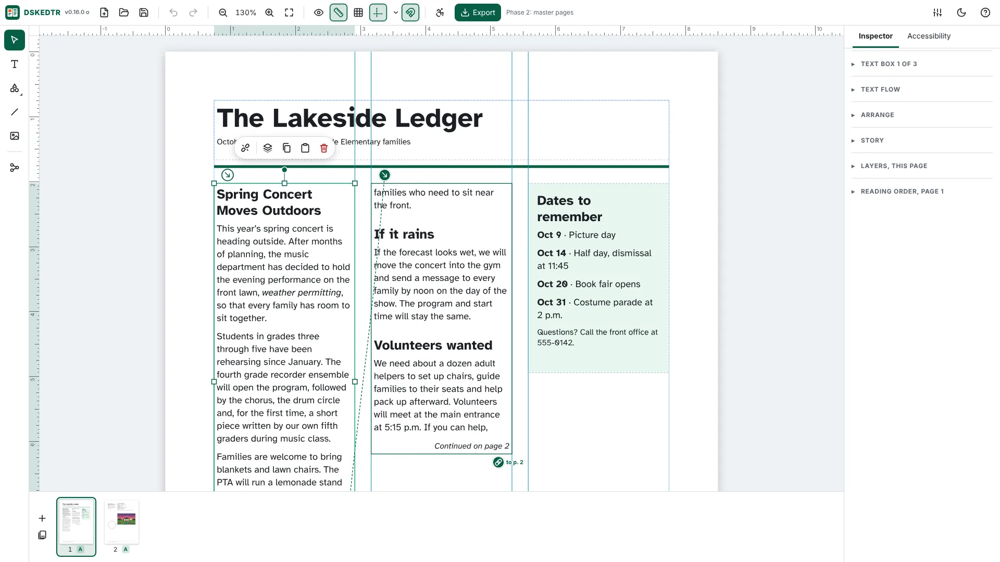<br><sub><b>Text that flows between boxes.</b></sub></td>
</tr>
</table>

More screenshots, with descriptions, are on the apps page
(the [`apps-landing`](apps-landing) folder).

## Using the apps

Open the address in a browser. Chrome and Edge give the fullest experience
(TXTEDTR, for example, can save straight back over the file you opened there,
while Firefox and Safari use a file picker and downloads instead). To install an
app, use the browser's "Install" option; it then opens in its own window and
keeps working offline.

## How this repository is organized

Each app has its own folder, named for the app. The page itself is
`index.html`, and each folder also has the icons, a web app manifest and a
service worker that make the app installable, plus a `CHANGELOG.md` with the
version history. Some folders also include a `README.md` or a `SPEC.md`.

```
txtedtr/      TXTEDTR
pdfedtr/      PDFEDTR
imgedtr/      IMGEDTR
sndedtr/      SNDEDTR
videdtr/      VIDEDTR
scrncstr/     SCRNCSTR
vctredtr/     VCTREDTR
3dedtr/       3DEDTR
dskedtr/      DSKEDTR
apps-landing/ the apps page, with the screenshots used above
```

To run one locally, serve its folder with any static server and open the
address it prints:

```
cd txtedtr
python3 -m http.server 8000
```

### Deployment

Each app is its own Cloudflare Worker, connected to this repository with the
folder as its root directory and `main` as its production branch. Pushing to
`main` redeploys the apps, and the app's address then serves the new version.

## License

[MIT](LICENSE). Copyright (c) 2026 corydave.
